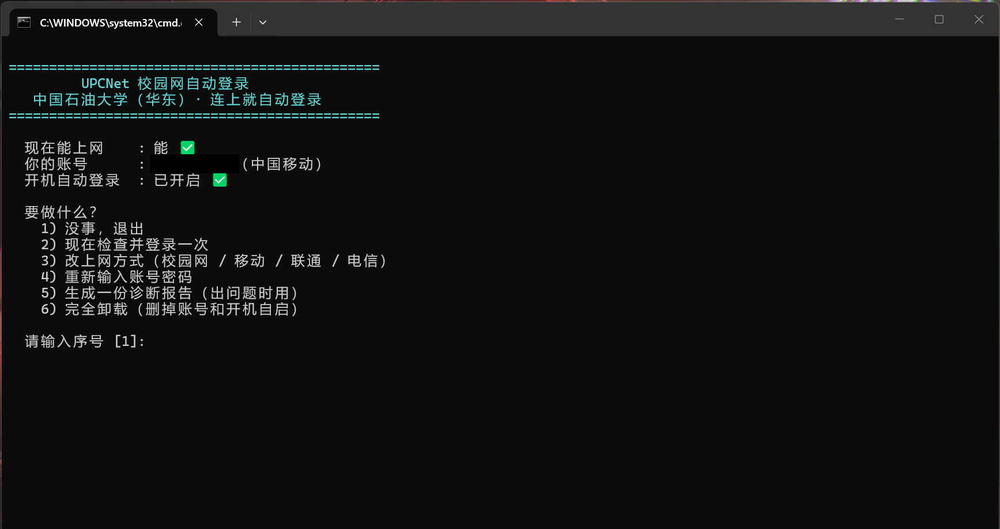
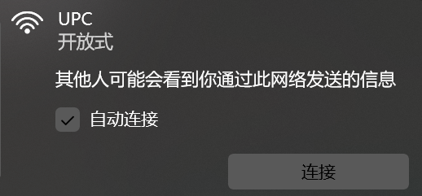

# UPCNet 校园网自动登录

中国石油大学（华东）校园网自动登录工具。

**连上校园网就自动登录，掉线自动重连 —— 以后不用再手动填学号密码。**

> ↑ 安装完之后，双击 `双击我.bat` 看到的就是这个面板。

---

## 它解决什么问题

在石大（华东），连上 `UPC` 这个 WiFi 或插上网线后，会弹出一个网页要你输学号和密码才能上网。
电脑休眠、断线、过夜之后，还得**再输一遍**。

这个小工具把这一步自动化了：

- 连上校园网 → **自动登录**
- 掉线了 → **自动重连**
- 开机 → 在后台自动运行，**你完全感觉不到它的存在**

---

## 怎么用（三步）

### 第 1 步：下载

点本页右上角绿色的 **`Code`** → **`Download ZIP`**，解压到任意位置（桌面就行）。

### 第 2 步：双击 `双击我.bat`

第一次运行会问你三件事：

| 问你什么 | 怎么填 |
|---|---|
| **学号** | 就是连校园网时网页上填的那个 |
| **密码** | 输入时屏幕上**不会显示字**，这是正常的（保护隐私），照常打就行 |
| **上网方式** | 不确定就**直接回车**（默认校园网）；也可以输入 `6` 让它自动试出来 |

### 第 3 步：完事

它会自动登录一次，并设置成开机自动运行。

> **以后你什么都不用点。**

---

## 常见问题

### 选错了上网方式怎么办？

双击 `双击我.bat` → 输入 `3` → 重新选。

不知道自己属于哪个运营商？选 `6`，它会一个个试出来。
（注意：这个要在**你连不上网的时候**才有用，因为要真的去试着登录。）

### 提示「余额已不足,请缴费!」

**这通常不是真的没余额，而是上网方式选错了。**

校园网认证系统有个坑：当你选错运营商时，服务器会去读**另一个空账户**的余额，于是报"余额已不足"。

处理办法：

1. 先去 [自助服务](http://self.upc.edu.cn/selfservice/) 看看你的套餐和余额是不是正常
2. 如果余额正常 → 就是选错运营商了 → 双击 `双击我.bat` → 输入 `3` → 选 `6` 自动试出来

### 我的账号密码安全吗？

- 密码用 **Windows 系统自带的加密功能**（DPAPI）加密后，存在**你自己电脑上**
- 把这个文件拷到别的电脑上，**打不开**
- 程序**不会**把你的密码发到除了学校认证服务器以外的任何地方
- 你可以在文件管理器地址栏粘贴 `%LOCALAPPDATA%\UPCNet-AutoLogin` 看到它

### UPC 是「开放式」网络，Windows 提示"其他人可能会看到你发送的信息"，安全吗？

**这个提示是 Windows 对所有开放 WiFi 的标准警告**，不是故障。

它的意思是：连这个 WiFi **不需要密码**，所以同一网络里的人**理论上能看到你发的未加密数据**。

**本工具不会因此泄露你的密码**，因为：

- 登录请求走的是 **HTTPS**（加密通道），密码在传输过程中是加密的
- 只有探测"是否已联网"的那几个请求会走 HTTP，但那一步**不涉及任何账号密码**

**你自己要注意的是**：别在这个开放网络下访问 `http://`（不带 s）的网站并输入密码——那才真的会被看到。

### 被浏览器或杀毒软件拦了？

`.bat` 文件被误报是很常见的事，选「仍要运行」即可。

本工具是**纯文本脚本**（一个 `.bat` + 一个 `.ps1` + 一个 `.vbs`），**你可以用记事本打开看里面到底写了什么**。看不懂也没关系——看得见，才敢用。

### 怎么卸载？

双击 `双击我.bat` → 输入 `6`。会删掉保存的账号和开机自启。

### 学校改了认证系统之后失效了？

很可能。校园网认证系统升级后，这个工具就会失灵。

遇到这种情况欢迎提 Issue，但不保证能及时修——学校什么时候改，我也控制不了。

---

## 支持的网络

| 网络 | 是否支持 |
|---|---|
| 有线网（宿舍网口） | ✅ 支持 |
| 无线 `UPC` | ✅ 支持 |
| `UPC-ChinaNet` / `UPC-ChinaUnicom` / `CMCC-EDU` / `eduroam` | ❌ 这些走 802.1X 认证，不需要本工具 |

---

## 高级工具

平时用不到，需要的时候在 `高级工具\` 文件夹里：

| 文件 | 干什么 |
|---|---|
| `查看状态.bat` | 看现在能不能上网、账号存了没、自启开了没 |
| `检查并尝试登录.bat` | 立刻检查一次并尝试登录 |
| `改上网方式.bat` | 改运营商（校园网 / 移动 / 联通 / 电信） |
| `诊断.bat` | 生成一份网络诊断报告（提 Issue 时附上） |
| `卸载.bat` | 卸载 |

程序本体是 `upcnet.ps1`（约 1000 行 PowerShell），配置文件都在 `%LOCALAPPDATA%\UPCNet-AutoLogin\`。

---

## 原理（给好奇的同学）

石大（华东）用的是**深澜 eportal** 网页认证系统。核心流程：

1. 访问任意 `http://` 地址，认证网关会把未登录的客户端 **302 重定向**到认证页，
   URL 的查询串里带着 `wlanuserip` / `nasip` / `wlanparameter`（你的网卡 MAC）/ `uerlocation`（交换机端口）
2. 把这段查询串作为 `queryString`，`POST` 到 `/eportal/InterFace.do?method=login`
3. 带上 `userId` / `password` / `service` / `passwordEncrypt=false`，返回 `result: success` 即登录成功

两个关键点：

- **登录必须走 HTTPS，不能用纯 IP 的 HTTP。** 密码是明文放在请求体里发的，走 HTTP 的话，
  在 `UPC` 这种**开放 WiFi** 上，同网络的人抓包就能看到你的学号密码。
  （探测阶段可以用 HTTP —— 那一步不涉及任何凭据。）
- **不能靠"跳转到哪个页面"判断是否已登录**：已登录时跳的是 `redirectortosuccess.jsp`，
  这个词里含有 `success.jsp`，模糊匹配必然误判。唯一可靠的判据是**能不能真的访问到外网**

---

## 免责声明

- 仅供本校同学方便上网使用，请使用**你自己的账号**
- 请勿共享账号、请勿用于任何商业用途
- 校园网认证系统由学校信息化部门管理，本工具与学校**无关**
- 使用本工具产生的任何后果由使用者自行承担

---

## 授权

[MIT](LICENSE)
